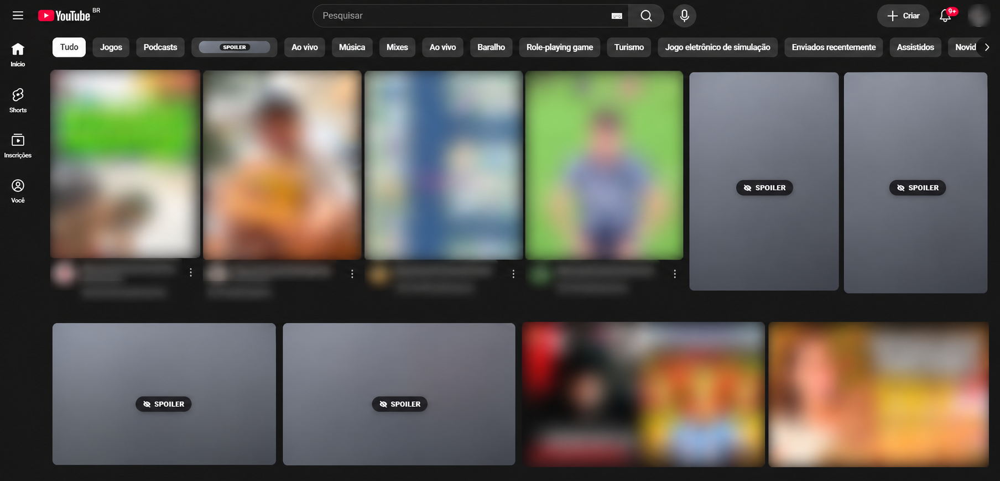
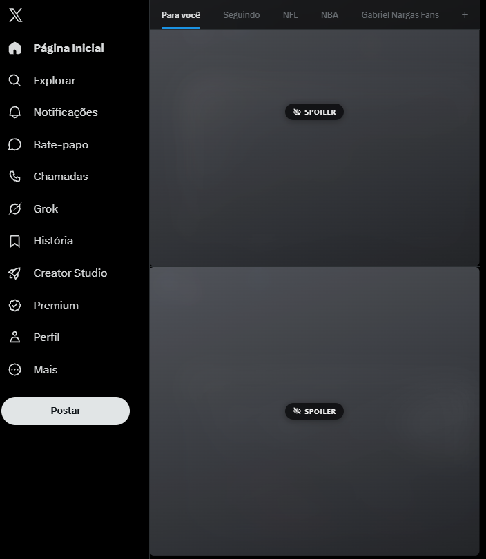
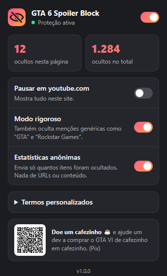
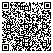

# GTA 6 Spoiler Block

Extensão para Google Chrome que esconde spoilers de **GTA 6** enquanto você navega. Posts, vídeos, imagens e notícias sobre o jogo ganham uma capa de **SPOILER** e só aparecem se você clicar.



## Instalação

A extensão não está na Chrome Web Store, então a instalação é manual e leva um minuto:

1. Baixe este repositório: no topo da página, clique em **Code** → **Download ZIP**. Se preferir, use `git clone`.
2. Extraia o zip numa pasta que você não vá apagar, por exemplo `Documentos/GTA-6-Block`. O Chrome lê a extensão dessa pasta, então ela precisa continuar lá.
3. Abra `chrome://extensions` na barra de endereço.
4. Ative o **Modo do desenvolvedor**, no canto superior direito.
5. Clique em **Carregar sem compactação** e selecione a pasta **`extension`** que está dentro da pasta extraída. É ela que contém o arquivo `manifest.json`; se você escolher a pasta de fora, o Chrome avisa que o manifesto está faltando.
6. Recarregue as abas que já estavam abertas. Se quiser, fixe o ícone pelo botão de extensões (🧩) da barra do Chrome.

Também funciona no Edge, Brave, Opera e outros navegadores baseados no Chromium: troque `chrome://extensions` por `edge://extensions`, `brave://extensions` ou `opera://extensions`.

### Atualizando

1. Baixe o repositório de novo (ou rode `git pull`, se usou `git clone`).
2. Substitua a pasta antiga pela nova, **no mesmo lugar**.
3. Em `chrome://extensions`, clique no botão de recarregar (↻) do card da extensão.

Suas configurações e contadores são mantidos.

## Funcionalidades

<p>
  
  
</p>

- **Oculta o card inteiro**: texto, thumbnail e vídeo juntos, e não apenas a palavra.
- **Funciona em qualquer site**, com ajustes específicos para X, YouTube, Reddit, Discord, Twitch, Kick, Bluesky, Threads, Facebook, LinkedIn, TikTok e Google.
- **Sem "piscar" o spoiler**: o conteúdo carregado depois (scroll infinito, navegação em SPAs) é coberto antes de ser desenhado na tela.
- **Bloqueio de página inteira** quando o título da página é sobre GTA 6, com pausa automática de vídeos.
- **Lê além do texto**: `alt`, `title`, `aria-label` e o nome do arquivo das imagens (`gta-6-lucia-trailer.jpg`).
- **Quase 200 termos**: variações do nome do jogo, personagens principais e secundários, regiões de Leonida, gangues, empresas, rádios, elenco e vazamentos.
- **Modo rigoroso**, **pausa por site** e **termos personalizados**, para os nomes que forem revelados depois do lançamento.
- Contador de itens ocultados no ícone e interface em **português e inglês**.

## Como funciona

### Detecção em três níveis

| Nível | Exemplos | Quando oculta |
| --- | --- | --- |
| Forte | `GTA 6`, `GTA VI`, `#GTA6Trailer`, `Jason Duval`, `Lucia Caminos`, `Leonida`, `Port Gellhorn`, `Boobie Ike` | Sempre |
| Contexto | `GTA`, `Grand Theft Auto`, `Rockstar Games`, `Take-Two` | Sozinho, só no modo rigoroso |
| Fraco | `Jason`, `Lucia`, `Brian`, `trailer`, `final`, `missão` | Só junto de um termo de contexto |

O texto é normalizado antes da comparação: minúsculas, sem acentos e com caracteres de compatibilidade convertidos (`Ⅵ` vira `vi`). Os termos respeitam fronteiras de palavra, então `Leonidas` não é confundido com `Leonida` e `GTA Vice` não conta como `GTA VI`.

### O que esconder

A partir do texto encontrado, a extensão sobe pela árvore do DOM procurando o melhor alvo:

1. um card conhecido do site (tweet, vídeo do YouTube, post do Reddit, mensagem do Discord...);
2. um card genérico (`article`, `li`, `[role=article]`...) de tamanho razoável;
3. o menor bloco ao redor que também contenha imagem ou vídeo;
4. o próprio bloco de texto.

### Detalhes de implementação

- Um `MutationObserver` processa as mudanças de forma síncrona. Como o callback roda antes da próxima pintura, o spoiler nunca aparece na tela.
- Cards reciclados pelo site (YouTube e X reaproveitam elementos) são verificados de novo quando o conteúdo muda.
- A capa é um Web Component com Shadow DOM fechado, construído com a API do DOM. Assim o CSS do site não interfere e funciona em páginas com Trusted Types, como o YouTube.
- O estado fica em atributos `data-*`, que sobrevivem a re-renderizações do React, e o conteúdo coberto recebe `inert`, deixando de ser focável e de ser lido por leitores de tela.
- Sem dependências e sem etapa de compilação: a pasta `extension/` é carregada direto no Chrome.

## Desenvolvimento

Carregue a pasta `extension/` como na instalação. Depois de editar, clique em recarregar (↻) no card da extensão e recarregue a aba.

Os scripts abaixo requerem Node.js 20 ou superior.

```bash
npm test           # testes do motor de detecção
npm run build      # empacota a extensão em release/gta6-spoiler-block-<versão>.zip
```

## Estrutura

```
extension/
  manifest.json
  _locales/              traduções (en, pt_BR)
  assets/                QR Code Pix
  icons/
  src/
    shared/keywords.js   lista de termos
    shared/matcher.js    motor de detecção
    shared/settings.js   configurações padrão
    content/             content script e estilos da capa
    background/          service worker (contador e badge)
    popup/               interface do ícone
scripts/build.mjs        empacotamento em .zip
supabase/                backend
tests/                   testes do motor de detecção
```

## Adicionando termos

Os termos ficam em [`extension/src/shared/keywords.js`](extension/src/shared/keywords.js), separados em `strong`, `context` e `weak`. Escreva cada termo como texto normal: maiúsculas, acentos, espaços, hífens e apóstrofos são tratados automaticamente. Depois rode `npm test`.

## Privacidade

Toda a análise das páginas acontece no seu navegador. Veja a [política de privacidade](PRIVACY.md).

## Apoie o projeto



**Doe um cafezinho ☕** e ajude um dev a comprar o GTA VI de cafezinho em cafezinho. (Pix)

## Aviso

Projeto independente feito por fã, sem vínculo com a Rockstar Games ou a Take-Two Interactive. Grand Theft Auto e GTA são marcas registradas de seus respectivos donos.

## Licença

[MIT](LICENSE)
